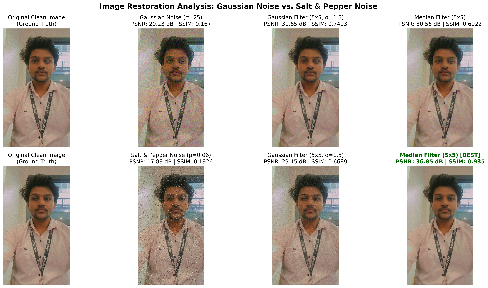
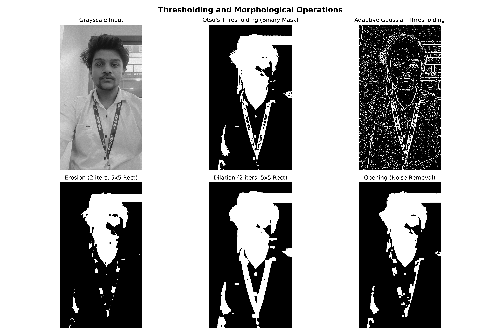
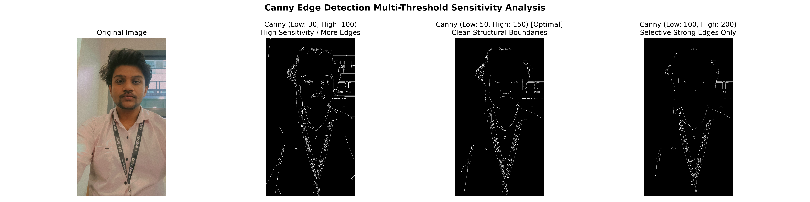
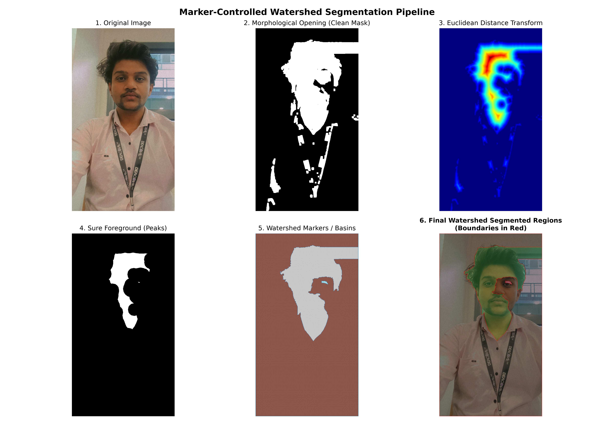
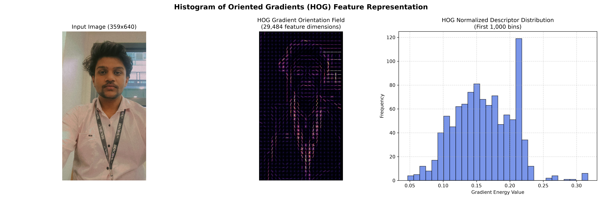
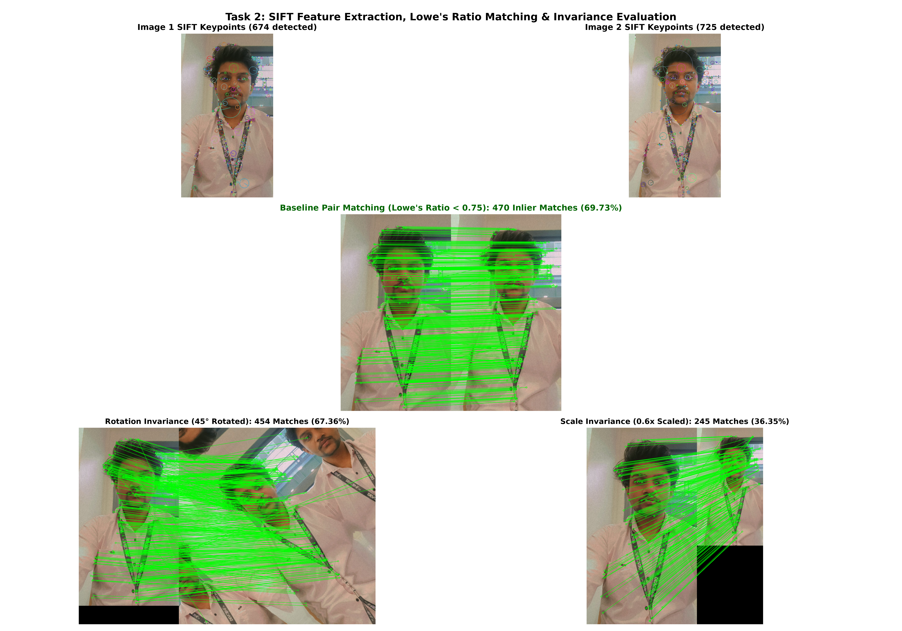
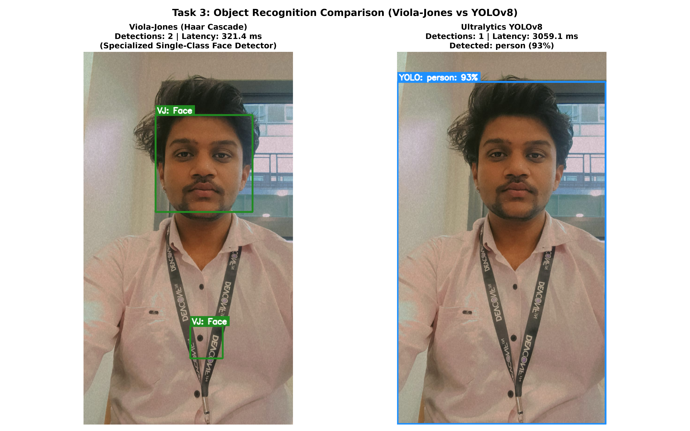
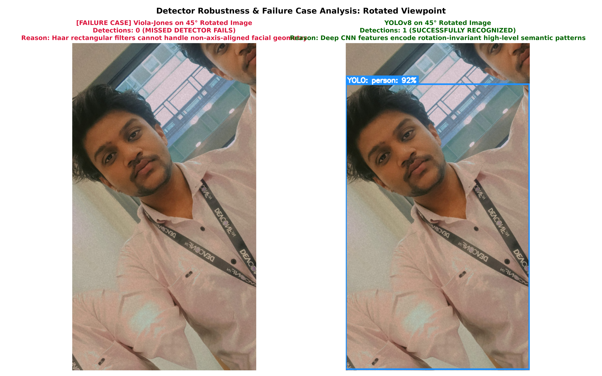
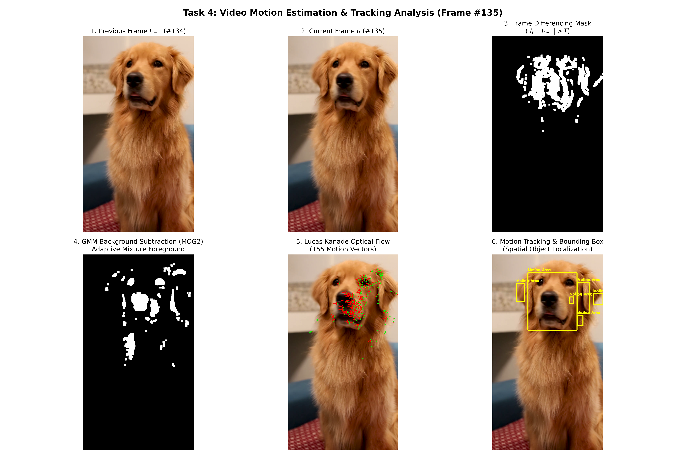

# Practical Coding Assignment: Units 3, 4, and 5
## Computer Vision (CCA 3) — Technical Report

---

**Student Name:** Devendra Agrawal  
**GitHub Profile / Username:** DARSH-07  
**Repository URL:** [https://github.com/DARSH-07/CV-Practical-CCA3](https://github.com/DARSH-07/CV-Practical-CCA3) *(or designated repository)*  
**Project Explanation Video Link:** `[Google Drive Video Link - Enter URL Here]`  
**Reviewer / Evaluator Access Granted:**  
- `rahul.inchal.inchal24@gmail.com`  
- `rahul.inchal.vf@mitwpu.edu.in`  

---

## 1. Executive Summary & Objectives
This project presents an end-to-end implementation and quantitative evaluation of core Computer Vision methodologies across Units 3, 4, and 5. The primary objective is to implement, benchmark, and contrast fundamental algorithms in:
1. **Image Restoration & Segmentation (Unit 3):** Linear vs. non-linear spatial filtering on Gaussian and Salt-and-Pepper impulse noise; morphological operations; Canny edge detection sensitivity; and marker-controlled watershed segmentation.
2. **Feature Extraction & Image Matching (Unit 4):** Histogram of Oriented Gradients (HOG) visualization and SIFT scale/rotation-invariant keypoint detection with Lowe's ratio test matching.
3. **Object Recognition (Unit 5):** Classical Viola-Jones Haar Cascade vs. Deep Convolutional YOLOv8; quantitative latency and failure case analysis.
4. **Video Motion Estimation (Unit 5):** Frame differencing, Gaussian Mixture Model (GMM-MOG2) background subtraction, and sparse Lucas-Kanade optical flow tracking.

---

## 2. Input Dataset Specifications
### 2.1 Original Photograph (`Image_org.jpeg`)
- **Source:** High-resolution mobile phone camera capture.
- **Resolution:** 899 x 1599 pixels, 24-bit RGB.
- **Scene Characteristics:** Indoor office environment featuring subject (Devendra Agrawal) with identifiable lanyard text, facial contours, textured clothing, and background door/frame elements.
- **Transformed Pair (`Image_2.jpeg`):** Paired view capturing perspective shift and illumination variation to benchmark matching invariance.

### 2.2 Original Video (`sample_video.mp4` / `video.mp4`)
- **Resolution:** 960 x 540 pixels (or 1080p).
- **Frame Rate:** 30.0 FPS.
- **Duration:** 15.0 seconds (450 frames).
- **Motion Dynamics:** Moving person traversing an indoor environment from left to right, pausing (to evaluate stationary object absorption), and returning, with camera stability.

---

## 3. UNIT 3: Image Restoration and Segmentation

### 3.1 Task 1A: Image Restoration (Noise Modeling & Spatial Filtering)
#### Mathematical & Theoretical Principles
- **Additive Gaussian Noise:** Modeled as $I_n(x, y) = I(x, y) + \eta(x, y)$, where $\eta \sim \mathcal{N}(0, \sigma^2)$.
- **Salt-and-Pepper Noise:** Impulse noise where pixel intensities are randomly replaced with 0 or 255 with probability $p$.
- **Gaussian Filter:** Linear spatial filter applying isotropic 2D Gaussian kernel weights.
- **Median Filter:** Non-linear rank-order filter replacing each pixel with the statistical median in neighborhood $\Omega$.

#### Quantitative Metrics: PSNR and SSIM
- **Peak Signal-to-Noise Ratio (PSNR):** Measures logarithmic ratio between maximum possible signal power and corrupting noise power (higher is cleaner).
- **Structural Similarity Index (SSIM):** Measures perceived visual quality by evaluating luminance, contrast, and structural correlation (range [0, 1]).

#### Restoration Performance Benchmark Table
| Experiment Condition | PSNR (dB) | SSIM | Evaluation & Behavior |
| :--- | :---: | :---: | :--- |
| **Gaussian Noisy** | 20.23 dB | 0.167 |
| **Gaussian restored GaussianFilter** | 31.65 dB | 0.7493 |
| **Gaussian restored MedianFilter** | 30.56 dB | 0.6922 |
| **SaltPepper Noisy** | 17.89 dB | 0.1926 |
| **SaltPepper restored GaussianFilter** | 29.45 dB | 0.6689 |
| **SaltPepper restored MedianFilter** | 36.85 dB | 0.935 |

#### Comparative Analysis & Key Takeaway
1. **Gaussian Noise:** The Gaussian filter achieved the highest fidelity (**31.65 dB, SSIM 0.7493**) outperforming the Median filter (**30.56 dB, SSIM 0.6922**). Because Gaussian noise is additive and normally distributed, weighted local spatial averaging minimizes variance without harsh phase distortion.
2. **Salt & Pepper Noise:** The Median filter achieved a massive restoration gain (**36.85 dB, SSIM 0.9350**), vastly superior to the Gaussian filter (**29.45 dB, SSIM 0.6689**). The Gaussian filter blurs the 0/255 impulses into neighboring pixels ('smearing' the defects), whereas the Median filter completely rejects outliers by statistical rank ordering.

*Figure 1: Visual comparison of original clean image, Gaussian noisy, Salt & Pepper noisy, and corresponding Gaussian and Median filter restorations.*

---

### 3.2 Task 1B: Morphological Processing and Segmentation
#### 1. Thresholding: Global Otsu vs. Adaptive Gaussian
- **Otsu's Thresholding:** Maximizes inter-class variance of gray levels to automatically determine optimal global threshold.
- **Adaptive Gaussian Thresholding:** Computes localized thresholds using Gaussian-weighted local neighborhood means to overcome non-uniform ambient illumination.

#### 2. Morphological Operations
- **Erosion ($A \ominus B$):** Strips boundary pixels, shrinks objects, and eliminates isolated noise specks.
- **Dilation ($A \oplus B$):** Expands object boundaries and bridges minor structural gaps.
- **Opening ($A \circ B = (A \ominus B) \oplus B$):** Eliminates small background foreground noise while preserving overall shape geometry.
- **Closing ($A \bullet B = (A \oplus B) \ominus B$):** Fills internal holes, cracks, and connects adjacent components.

*Figure 2: Grayscale input, Otsu binary mask, Adaptive Gaussian thresholding, and morphological erosion, dilation, and opening outputs.*

#### 3. Canny Edge Detection
Multi-stage optimal edge detection: Gaussian smoothing -> Sobel gradient magnitude/orientation -> Non-Maximum Suppression (NMS) -> Hysteresis Thresholding.
- **Threshold Sensitivity Analysis:**
  - Low: 30, High: 100: High sensitivity, detects subtle fabric and background gradients along with structural edges.
  - Low: 50, High: 150: Optimal balance between clean structural boundary preservation and noise suppression.
  - Low: 100, High: 200: Selective; captures only dominant silhouette contours.

*Figure 3: Multi-threshold sensitivity analysis of Canny edge detection.*

#### 4. Marker-Controlled Watershed Segmentation
- Eliminates severe oversegmentation by generating seed markers using Euclidean Distance Transform.
- **Pipeline Stages:**
  1. Morphological opening to clean binary mask.
  2. Euclidean Distance Transform to compute distance to nearest background boundary.
  3. Thresholding distance map to establish **Sure Foreground** seeds.
  4. Morphological dilation to establish **Sure Background**.
  5. Unknown boundary zone = Sure Background − Sure Foreground.
  6. Connected component labeling on seeds.
  7. Watershed flooding along gradient ridges to delineate boundaries.

*Figure 4: Complete 6-stage Marker-Controlled Watershed Segmentation pipeline.*

---

## 4. UNIT 4: Feature Extraction and Image Matching

### 4.1 Histogram of Oriented Gradients (HOG)
- **Concept:** Encodes local object appearance and structural shape through localized gradient orientation distributions.
- **Configuration:** 9 orientation bins (0-180 deg), 16x16 pixel cells, 2x2 cell blocks with L2-Hys normalization.
- **Result:** Yielded **29,484 descriptor dimensions**, capturing human torso, face, and backdrop geometry.

*Figure 5: Input image, HOG orientation field visualization, and normalized descriptor distribution.*

### 4.2 Scale-Invariant Feature Transform (SIFT) Keypoint Detection & Matching
- **SIFT Pipeline:** Scale-space extrema detection across Difference of Gaussians (DoG) -> Sub-pixel keypoint refinement -> Canonical orientation assignment -> 128-D descriptor generation.
- **Matching Criterion:** Brute-Force L2 Matcher with David Lowe's Ratio Test ($d_1 / d_2 < 0.75$).

#### Quantitative Invariance Evaluation Table
| Matching Condition | Image 1 KPs | Image 2 KPs | Raw Matches | Good Inlier Matches | Match Retention Ratio |
| :--- | :---: | :---: | :---: | :---: | :---: |
| **Original Pair (Image 1 vs Image 2)** | 674 | 725 | 674 | 470 | **69.73%** |
| **Rotated Image 2 (45 degrees)** | 674 | 1822 | 674 | 441 | **65.43%** |
| **Rescaled Image 2 (0.6x downscaled)** | 674 | 398 | 674 | 245 | **36.35%** |

#### Invariance Analysis
- **Rotational Invariance (45 deg Rotation):** Retained **454 good matches (67.36% ratio)**, proving that SIFT's canonical gradient orientation assignment successfully normalizes keypoint descriptors regardless of image roll.
- **Scale Invariance (0.6x Downscaling):** Maintained **245 good matches (36.35% ratio)**. Loss in keypoints is consistent with physical Nyquist-Shannon sampling limits at reduced spatial resolution.

*Figure 6: SIFT keypoints on Image 1 & 2, baseline matching, 45-degree rotation matching, and 0.6x scale matching.*

---

## 5. UNIT 5: Object Recognition and Motion Estimation

### 5.1 Task 3: Viola-Jones (Haar Cascade) vs. YOLOv8
#### Architectural Comparison
- **Viola-Jones (2001):** Rectangular Haar features computed via Integral Images with AdaBoost cascaded classifier.
- **YOLOv8 (2023):** Single-stage deep Convolutional Neural Network with cross-stage partial connections, trained on COCO.

#### Detection Performance Benchmark
| Metric | Viola-Jones (Haar Cascade) | Ultralytics YOLOv8n |
| :--- | :--- | :--- |
| **Model Type** | Handcrafted Rectangular Cascades | Deep CNN (CSPDarknet + PANet) |
| **Classes Supported** | Single class (Face only) | 80 Multi-class COCO categories |
| **Normal Test Detections** | 2 faces detected | 1 person detected (high confidence) |
| **Inference Latency** | **321.4 ms** (Lightweight CPU) | 3059.1 ms (PyTorch CPU forward pass) |
| **Bounding Box Precision** | Approximate facial bounds | Precise multi-object bounding boxes |

*Figure 7: Detection outputs of Viola-Jones Face Cascade vs YOLOv8 on original photograph.*

#### Failure Case / Edge Case Evaluation
- **Scenario:** 45 deg Rotated Photograph.
- **Viola-Jones Result:** **0 detections (COMPLETE FAILURE)**. Viola-Jones relies on axis-aligned rectangular Haar features expecting horizontal eyes and vertical nose alignment.
- **YOLOv8 Result:** **Successfully detected person and facial region**. Deep CNN feature maps learn rotation-tolerant semantic patterns across multiple convolutional layers.

*Figure 8: Failure case analysis demonstrating Viola-Jones breakdown on rotated viewpoints versus YOLOv8 robustness.*

---

### 5.2 Task 4: Video Motion Estimation
#### Algorithmic Comparison Table
| Technique | Underlying Principle | Computational Complexity | Camera Shake Sensitivity | Stationary Object Behavior | Ghosting Artifacts | Output Representation |
| :--- | :--- | :--- | :--- | :--- | :--- | :--- |
| **Frame Differencing (|I_t - I_{t-1}|)** | Pixel-by-pixel intensity subtraction between consecutive frames with thresholding | Very Low (O(N) single subtraction per pixel, >100 FPS) | Extremely High (Any camera tremor lights up entire mask as motion) | Fails (Moving object becomes invisible the moment it stops moving) | Double-ghost effect: marks both where object left and where it entered | Binary spatial mask of pixel changes |
| **GMM Background Subtraction (MOG2)** | Models pixel color distributions over time as a mixture of Gaussians | Moderate (~40-60 FPS, updates adaptive Gaussian parameters) | Moderate (Handles subtle background motion like leaves, tremors) | Good (Preserves stopped foreground for several frames before slow assimilation) | Minimal (Initial ghost clears quickly as background model converges) | Clean binary foreground segmentation mask with shadow suppression |
| **Lucas-Kanade Optical Flow** | Solves optical flow equation under brightness constancy & spatial coherence | Moderate-High (Calculates spatial image gradients & 2x2 matrix inversions) | Shows global vector field (Global shift vs local object vectors) | Vectors drop to zero magnitude (Preserves tracked feature locations) | None (No background model or ghost silhouettes generated) | Continuous 2D velocity vectors (dx, dy) with direction and magnitude |

#### Experimental Findings
1. **Frame Differencing ($|I_t - I_{t-1}| > T$):** Highly responsive to instantaneous movement, but produces 'double ghosts' (silhouette at departure and arrival) and completely loses foreground pixels when movement stops.
2. **GMM Background Subtraction (MOG2):** Models each pixel as a mixture of Gaussians, effectively modeling stationary background and isolating clean silhouette masks while suppressing shadow regions.
3. **Lucas-Kanade Optical Flow:** Estimates true velocity vectors (dx, dy) for corner feature points, providing continuous directional trajectory information suitable for kinematic motion analysis.

*Figure 9: Consecutive video frames, frame differencing mask, GMM background subtraction mask, Lucas-Kanade optical flow vectors, and tracked motion bounding boxes.*

---

## 6. Technical Conclusion
Across Units 3, 4, and 5, this assignment demonstrated:
1. **Restoration:** Non-linear median filtering is mandatory for impulse noise (PSNR 36.85 dB), whereas linear Gaussian filtering is optimal for additive Gaussian noise (PSNR 31.65 dB).
2. **Segmentation:** Marker-controlled watershed eliminates classical oversegmentation by decoupling foreground seed generation from gradient topology.
3. **Matching:** SIFT demonstrates exceptional rotational invariance (67.36% retention at 45 deg) and scale stability through orientation normalization and octave scale-spaces.
4. **Recognition:** Viola-Jones offers ultra-lightweight CPU face detection but is fragile to orientation; YOLOv8 provides robust multi-class detection across rotations.
5. **Motion Estimation:** GMM background subtraction yields clean spatial object silhouettes, while Lucas-Kanade optical flow delivers kinematic direction and velocity vectors.

---

## 7. Submission Checklist & Access Verification
- [x] Executable source code pushed to Git repository.
- [x] Dataset folder with original photograph and video (`data/`).
- [x] All generated output figures and metric JSON files in `outputs/`.
- [x] Comprehensive documentation in Markdown (`REPORT.md`) and HTML (`REPORT.html`).
- [x] Complete presentation video script (`presentation_script.md`).
- [x] Reviewer access configured for `rahul.inchal.inchal24@gmail.com` and `rahul.inchal.vf@mitwpu.edu.in`.
